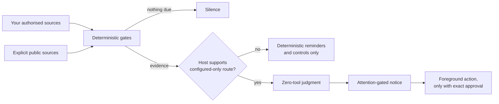

# hermes-proactive-secretary

A conservative, opt-in proactive secretary for [Hermes](https://hermes-agent.nousresearch.com). It reads only the sources you explicitly authorise, judges whether anything is genuinely worth interrupting you for, and stays silent otherwise. It never sends mail, changes calendars or tasks, books, purchases, publishes, or expands its own access.

Version **0.6.2** is a pre-1.0 release. The default posture is user-agnostic: no accounts, no public seeds, no personal interests, and no assumed location. Every source and permission is opt-in. This patch keeps transient discovery failures and privacy-budget deferrals from consuming bounded replacement attempts or advancing the cooldown.

## Features

- **Read-only by design**: bounded collection from only the mail, calendar, tasks and public feeds you explicitly grant.
- **Low-noise judgment**: deterministic gates plus an optional zero-tool model judgment; one short message at most per run.
- **Requested reminders**: durable, deterministic exact-time or event-bound reminders, separate from the ordinary attention envelope.
- **Conversational onboarding**: the first eligible one-to-one chat starts a resumable interview; no settings edit required.
- **Private preparation (opt-in)**: bounded, cited private drafts for accepted responsibilities; handoff never executes.
- **Public discovery (opt-in)**: bounded, keyless public sources and topics; private facts never become public queries.
- **Adaptive public monitoring**: with consent, verify and reversibly replace defective public sources; feedback shapes future monitoring, and configuration suggestions await approval.
- **Native controls**: owned `--no-agent` cron jobs, ordinary chat commands, and a custom Settings ▸ Plugins page.
- **Honest states**: installed, configured, scheduled and delivery-confirmed stay distinct; emitted is not delivered.

## How it works



The secretary collects bounded, read-only evidence; applies quiet hours, a daily ceiling, cooldown, dedupe and expiry; and writes at most one short message per run to stdout. The native Hermes scheduler owns actual delivery.

## Install

**Desktop:** [Install in Hermes](hermes://plugin/install?repo=Akuyumu/hermes-proactive-secretary&enable=1) opens the native confirmation dialog. If your browser does not open the link, use **Capabilities → Plugins → Install from Git**, entering `Akuyumu/hermes-proactive-secretary`.

**Terminal:**

```bash
hermes plugins install Akuyumu/hermes-proactive-secretary --enable
hermes secretary doctor
```

Follow Hermes' dependency and capability consent prompts. This private repository requires Git access on the installing machine. For exact-commit installs and other options, see the [official plugin guide](https://hermes-agent.nousresearch.com/docs/user-guide/features/plugins#managing-plugins).

## Onboard and arm

Onboarding is conversational. Send any ordinary message in a one-to-one DM with the bot: on a fresh profile the interview starts there. `/secretary setup` is a fallback and can resume a gap-only interview. Onboarding records a destination as user-confirmed, never live-verified, and **arms no jobs**.

Configuration or onboarding alone does not arm or deliver anything. After reviewing the preview, arm explicitly, starting with local/no-send:

```bash
hermes secretary setup --deliver local   # safe local/no-send first
hermes secretary setup --deliver telegram
hermes secretary status --json
hermes secretary doctor
```

The plugin creates and records ownership of the monitoring and reminders jobs. Use `--with-preparation` only if you explicitly want the optional preparation job. If you cannot verify a destination, keep `--deliver local`; the honest state is `unverified`.

## Compatibility

Model-dependent work requires an explicit host contract: `register_auxiliary_task(..., fallback_policy="configured_only")`. The plugin detects that keyword on the host signature; a wrapper that merely accepts `**kwargs` is not proof. On a host without the contract, model work is blocked before dispatch while deterministic controls and requested reminders continue.

The plugin does not patch Hermes or install this host contract for you. Installation alone is not proof of compatibility; verify the installed host with `hermes secretary status` and `hermes secretary doctor`. Do not bypass the gate or assume an arbitrary upstream version supports it.

## Requirements

- Hermes with the native plugin and cron surfaces; Linux or macOS. Windows and fresh-machine portability are not independently certified.
- Python dependencies provided by the Hermes runtime; the plugin does not install a second runtime.
- Optional connectors only when already authorised: Himalaya CLI for read-only mail metadata; the external `productivity-secretary` library for calendar/tasks, or the Google Workspace calendar adapter with its installed skill and existing authorisation; a native messaging target such as a Telegram DM.

The source is MIT-licensed, but the canonical repository is currently private. Installation requires access to `Akuyumu/hermes-proactive-secretary`.

## Documentation

- [Operations guide](docs/operations.md): detailed setup, settings, reminders, preparation, privacy, migration and troubleshooting.
- [Adaptive maintenance](docs/adaptive-maintenance.md): per-source public truth, reversible replacement and configuration proposals.
- [Onboarding design](docs/agentic-onboarding-design.md): the conversational product contract.
- [Notification contract](docs/notification-contract.md): attention limits and delivery honesty.
- [Agent setup](AGENT_SETUP.md) and the [operational skill](skills/proactive-secretary/SKILL.md): agent-assisted installation.
- [GitHub Releases](https://github.com/Akuyumu/hermes-proactive-secretary/releases): change history and per-version qualification.

## License

MIT. See [LICENSE](LICENSE).
